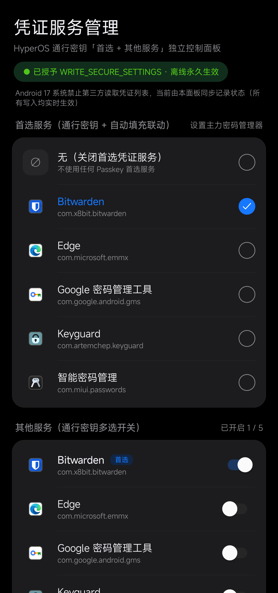
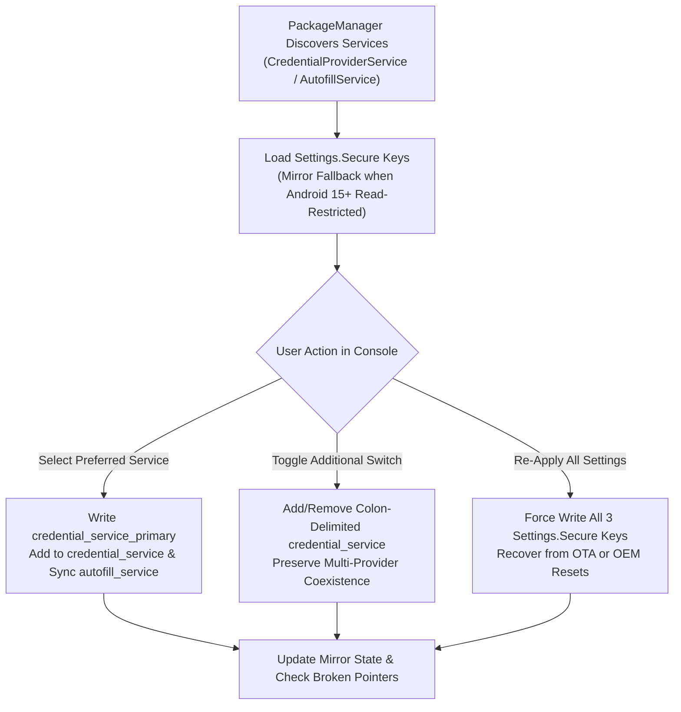

[English](README.en.md) | [简体中文](README.md)

<div align="center">
  
  <h1>Android Credential Switcher</h1>
  <p>
    <b>No-Root, No-Shizuku Offline Console for Android 14–17 &amp; HyperOS Passkey Services</b><br>
    Restore missing "Preferred + Additional Services" toggles on Xiaomi HyperOS 3/4, ColorOS, OriginOS, and MagicOS with a one-time ADB grant.
  </p>
  <p>
    <a href="https://developer.android.com/training/sign-in/passkeys"></a>
    <a href="AndroidManifest.xml"></a>
    <a href="docs/ARCHITECTURE.en.md"></a>
    <a href="LICENSE"></a>
    <a href="https://github.com/ToruOlenyeva/android-credential-switcher/stargazers"></a>
  </p>
</div>

> <b>Bring back hidden Passkey multi-provider switches on OEM Android skins</b>: Built for <b>Android 14–17</b> (including <b>Xiaomi HyperOS 3/4</b>, <b>OPPO ColorOS</b>, <b>vivo OriginOS</b>, and <b>Honor MagicOS</b>). On HyperOS 4 and several customized ROMs, the system Settings UI omits the "Additional services" list under Passwords and accounts (`CREDENTIAL_PROVIDER`), preventing users from enabling Bitwarden alongside Keyguard or Google Password Manager. This zero-network utility writes the standard `Settings.Secure` keys directly via `WRITE_SECURE_SETTINGS`, surviving reboots and remaining active after turning off Developer Options.

<div align="center">
  
</div>

---

## ✨ Key Features

- <b>Full Preferred + Additional Services Control</b>: Manage both single-select Preferred Service and multi-select Additional Services, allowing Bitwarden, Keyguard, Edge, and Google Password Manager to stay enabled concurrently.
- <b>No Root, No Shizuku, Reboot Persistent</b>: Requires only a one-time `adb shell pm grant` command for `WRITE_SECURE_SETTINGS`. Unlike Shizuku-based tools, it persists across reboots and continues working after disabling USB Debugging and Developer Options.
- <b>Zero Network Permission &amp; Ultra-Lightweight</b>: Contains zero `INTERNET` permission and zero third-party dependencies (no AndroidX, Compose, or Gradle). Four clean Java files compile into an APK under `40 KB`.
- <b>Mirror State Sync for Android 15–17 Read Restrictions</b>: Automatically works around non-privileged read restrictions on `credential_service` via first-launch `autofill_service` inspection and local `SharedPreferences` mirroring, while keeping all system writes live.
- <b>Stale Pointer Cleanup &amp; One-Tap OTA Re-Apply</b>: Detects broken component strings left behind by uninstalled managers and provides a "Re-Apply Config to System" action to recover instantly if an OEM security service or OTA resets defaults.
- <b>Runtime Bilingual UI &amp; Adaptive Theme</b>: Automatically follows device language on launch with an instant `EN / Chinese` header toggle pill and native Day/Night AMOLED styling.

---

## ⚖️ Solution Comparison

| Criterion | Android Credential Switcher | Shizuku-Based Switchers | Root / LSPosed Modules |
| :--- | :--- | :--- | :--- |
| <b>Root Access</b> | Not required | Not required | Required |
| <b>Shizuku Background Service</b> | Not required | Required (must re-pair after reboot) | Not required |
| <b>Keep Developer Options Off</b> | Supported after one-time grant | Breaks when Wireless Debugging is disabled | Supported |
| <b>Multi-Service Passkey Switches</b> | Full support | Full support | Dependent on ROM UI or custom hooks |
| <b>Locked-Vault Fallback Fix</b> | Documented diagnosis (unlock or LSPosed) | Not supported | Supported (via selector intent hooks) |
| <b>Network &amp; APK Footprint</b> | Zero network (&lt; 40 KB) | Often includes update checks (several MB) | Depends on LSPosed framework |

---

## 🔄 Core Workflow



---

## 🚀 Quick Installation & One-Time Grant

> <b>Why is an external grant required once?</b>: `WRITE_SECURE_SETTINGS` is an Android signature/development protection-level permission. Apps cannot ask for it with an in-app runtime popup—it must be issued once via `pm grant`. <b>Choose either Option A (PC) or Option B (PC-free on-device) below; once granted, you can turn off debugging and uninstall any helper app, and the permission stays active permanently.</b>

### 1. Download and Install APK

Grab the latest `android-credential-switcher-v1.0.0.apk` from [GitHub Releases](https://github.com/ToruOlenyeva/android-credential-switcher/releases) and install it on your device.

### 2. Option A: One-Time Grant via PC USB (Recommended)

1. If `adb` is not installed yet, download [Android SDK Platform-Tools](https://developer.android.com/tools/releases/platform-tools) and extract it.
2. Temporarily open Developer Options on your phone and enable the required debugging toggles:
   - <b>Xiaomi / HyperOS / MIUI</b>: enable "USB debugging" and <b>"USB debugging (Security settings)"</b>
   - <b>OPPO / OnePlus / Realme (ColorOS)</b>: enable "USB debugging" and <b>"Disable permission monitoring"</b>
   - <b>vivo (OriginOS) / Honor (MagicOS) / Pixel / Samsung</b>: enable "USB debugging"
3. Connect the phone over USB (accept the "Allow USB debugging" prompt), then run the command for your OS:

<b>macOS / Linux</b>:
```bash
adb shell pm grant io.github.toruolenyeva.credswitcher android.permission.WRITE_SECURE_SETTINGS
```

<b>Windows (PowerShell)</b>:
```powershell
adb shell pm grant io.github.toruolenyeva.credswitcher android.permission.WRITE_SECURE_SETTINGS
```

<b>Windows (CMD)</b>:
```cmd
adb shell pm grant io.github.toruolenyeva.credswitcher android.permission.WRITE_SECURE_SETTINGS
```

### 3. Option B: PC-Free On-Device Grant (Wireless Debugging)

If you do not have a computer handy, you can run the one-time grant directly on the phone using a local ADB shell app:

1. Temporarily enable "Wireless debugging" in your phone's Developer Options.
2. Install and pair a local ADB shell tool (such as <b>LADB</b>, or <b>Shizuku + aShell / Termux</b>) once using the 6-digit pairing code.
3. Run the command below inside that local shell (without the `adb shell` prefix):

```bash
pm grant io.github.toruolenyeva.credswitcher android.permission.WRITE_SECURE_SETTINGS
```

4. After confirming the grant works, turn off Wireless debugging and Developer Options; <b>you can even uninstall Shizuku / LADB right away</b> without losing permission.

### 4. Verification & Permission Lifecycle

Open Credential Switcher and verify the green pill reads <b>"WRITE_SECURE_SETTINGS Granted · Offline Persistent"</b>. You can now safely disable USB Debugging and Developer Options.

| Scenario | Permission Kept? | Re-Grant or Action Needed? |
| :--- | :--- | :--- |
| <b>Normal power off / reboot</b> | Kept permanently | None |
| <b>Turn off USB Debugging, Wireless Debugging &amp; Developer Options</b> | Kept permanently | None |
| <b>Update install over existing APK</b> | Kept permanently | None |
| <b>System OTA / security patch update</b> | Kept permanently | None (tap "Re-Apply Config to System" in-app if the OEM resets defaults) |
| <b>New device / uninstall &amp; reinstall / factory reset</b> | Must re-grant | Run Option A or Option B once again |

### 5. Optional: Build from Source (Zero Gradle)

Requires only JDK 17+ and Android SDK (platform `android-34` or higher + Build-Tools), with no Gradle installation needed:

<b>macOS / Linux</b>:
```bash
chmod +x build.sh && ./build.sh
```

<b>Windows (PowerShell)</b>:
```powershell
.\build.ps1
```

---

## 📖 Usage Guide

### 1. Set Preferred Service (Primary Password Manager)
- Tap your primary manager (e.g., Bitwarden) in the "Preferred Service" card.
- The app writes `credential_service_primary`, ensures the component is included in `credential_service`, and automatically links matching-package `autofill_service`.

### 2. Toggle Additional Services (Multi-Provider Passkeys)
- Flip switches in "Additional Services" to enable any combination of Credential Providers concurrently (for example Bitwarden, Keyguard, and Google Password Manager).
- The active primary provider displays a "Primary" badge; disabling the primary provider's switch cleanly clears `credential_service_primary` to keep state consistent.

### 3. Re-Apply Config After OTA / Security Center Reset
- If a system update or OEM background service resets your default Passkey settings, you do not need a PC or ADB again.
- Open the app and tap <b>"Re-Apply Config to System (Fix OTA Reset)"</b> to restore all three keys immediately.

### 4. HyperOS 4 Passkey Troubleshooting Insights
- <b>Why does Passkey login still fall back to Google sometimes?</b>: Bytecode inspection of HyperOS 4 `MiuiCredentialManager` confirms Xiaomi's custom selector omits locked-vault `AuthenticationEntryInfo` cards ("Unlock vault"). When all enabled managers are locked or lack a passkey for the site, the selector cancels silently and browsers fall back to Google. Keep your vault unlocked with autostart, unrestricted battery, and recents lock enabled.
- <b>Why does a single prompt vs multi-provider list appear inconsistently?</b>: The picker only displays multi-select choices when <b>2 or more</b> enabled and unlocked managers hold matching passkeys for the target domain; a single matching entry opens a direct confirmation prompt.

---

## 📚 Documentation Matrix

| Module | Description & Technical Details | Link |
| :--- | :--- | :--- |
| <b>System Architecture</b> | `Settings.Secure` three-key contract, Android 15+ read-restriction mirror algorithm, HyperOS 4 selector analysis | [View Architecture](docs/ARCHITECTURE.en.md) |
| <b>Changelog</b> | `v1.0.0` release notes and feature checklist | [View Changelog](CHANGELOG.md) |
| <b>Open-Source License</b> | MIT License full text | [View License](LICENSE) |

---

## 🤝 Contributors & Credits

- <b>[Toru Olenyeva](https://github.com/ToruOlenyeva)</b>
- <b>[Google Antigravity](https://antigravity.google/)</b>

---

## 📄 License

This project is licensed under the [<b>MIT License</b>](LICENSE).
