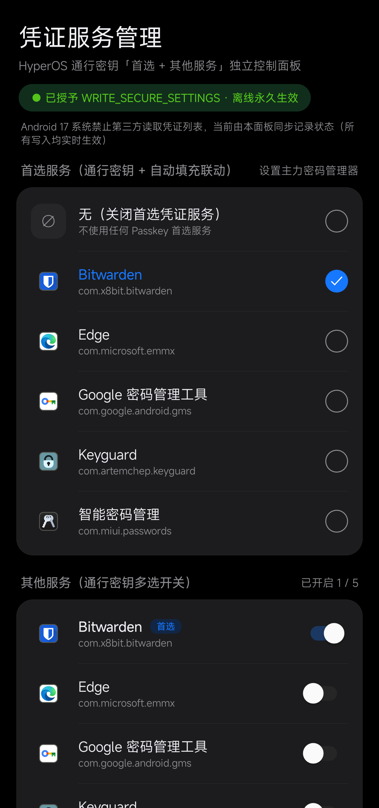
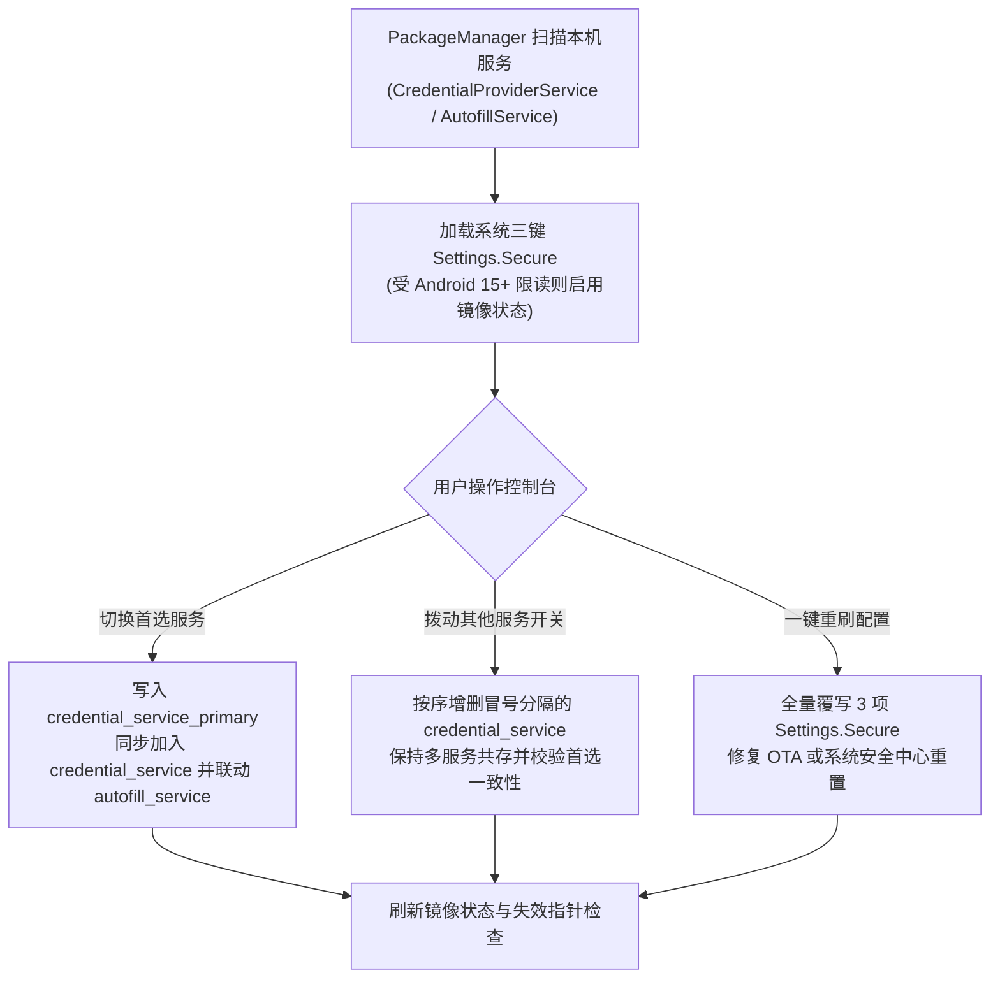

[English](README.en.md) | [简体中文](README.md)

<div align="center">
  
  <h1>Android Credential Switcher</h1>
  <p>
    <b>免 Root / 免 Shizuku 的 Android 14–17 与 HyperOS 通行密钥「首选 + 其他服务」离线控制面板</b><br>
    针对小米 HyperOS 3/4、ColorOS、OriginOS、MagicOS 等定制系统缺失「其他服务」开关的问题，一次 ADB 授权即可永久离线接管。
  </p>
  <p>
    <a href="https://developer.android.com/training/sign-in/passkeys"></a>
    <a href="AndroidManifest.xml"></a>
    <a href="docs/ARCHITECTURE.md"></a>
    <a href="LICENSE"></a>
    <a href="https://github.com/ToruOlenyeva/android-credential-switcher/stargazers"></a>
  </p>
</div>

> <b>找回被厂商定制系统隐藏的通行密钥多选开关</b>：面向 <b>Android 14–17</b>（含 <b>小米 HyperOS 3/4</b>、<b>OPPO ColorOS</b>、<b>vivo OriginOS</b>、<b>荣耀 MagicOS</b>）。在小米 HyperOS 4 等系统设置中，进入「密码和账号」或 `CREDENTIAL_PROVIDER` 页面时往往只能选单个「首选服务」，底部的「其他服务」多选开关列表为空，导致无法同时开启 Bitwarden、Keyguard、Google 密码管理工具等多个 Passkey 提供方。本应用零网络权限，仅靠标准 `WRITE_SECURE_SETTINGS` 权限直接控制 `Settings.Secure` 三键，授权后关闭开发者选项与重启依然永久生效。

<div align="center">
  
</div>

---

## ✨ 核心特性

- <b>完整恢复「首选 + 其他服务」双层控制</b>：同时提供「首选服务」单选与「其他服务」多选开关，支持将 Bitwarden 设为首选的同时开启 Keyguard、Edge 或 Google 等多个 Passkey 提供方。
- <b>免 Root、免 Shizuku、离线永久生效</b>：通过标准 `adb shell pm grant` 授予一次性 `WRITE_SECURE_SETTINGS` 权限；授完即可关闭 USB 调试与开发者选项，重启手机后依然长期有效，无需像 Shizuku 一样每次重启重新激活。
- <b>零网络权限与极简纯原生体积</b>：安装包不含 `INTERNET` 权限，不引入 AndroidX / Compose / Gradle 等任何第三方库，4 个轻量 Java 文件离线编译产物不足 `40 KB`。
- <b>兼容 Android 15–17 读取限制的镜像状态同步</b>：系统对普通应用屏蔽 `credential_service` 直读后，自动结合可读的 `autofill_service` 与本地 `SharedPreferences` 精准追踪配置，每次拨动均真实写入系统。
- <b>失效指针清理与一键防重置重刷</b>：自动扫描已卸载或残缺的服务组件指针并支持一键清理；针对小米安全中心或系统 OTA 重置默认配置的场景，提供「一键重刷配置到系统」按钮秒级恢复。
- <b>全链路中英双语与自适应浅暗主题</b>：首次打开自动跟随系统语言，右上角支持 `EN / 中文` 一键实时切换，配色严格对齐浅色与 AMOLED 暗色模式。

---

## ⚖️ 方案对比

| 维度 | Android Credential Switcher | Shizuku 类切换工具 | Root / LSPosed 模块 |
| :--- | :--- | :--- | :--- |
| <b>Root 权限</b> | 无需 | 无需 | 必需 |
| <b>Shizuku 常驻</b> | 无需 | 必需（每次重启需重开无线调试） | 无需 |
| <b>关闭开发者选项</b> | 授完一次即可关闭 | 关闭无线调试后即失效 | 支持 |
| <b>多服务 Passkey 开关</b> | 完整支持 | 完整支持 | 依赖系统界面或特定 Hook |
| <b>锁库回退谷歌修复</b> | 提供原因排查（需解锁或配合 LSPosed） | 不支持 | 支持（如 Hook 替换选择器） |
| <b>网络权限与体积</b> | 零网络权限（< 40 KB） | 通常含联网检查（数 MB） | 依赖 LSPosed 框架 |

---

## 🔄 核心工作流原理



---

## 🚀 快速安装与一次性授权

> <b>为什么需要一次外部授权？</b>：`WRITE_SECURE_SETTINGS` 属于 Android 保护级系统权限，系统禁止任何应用在机身内部弹窗请求「允许」，必须由用户通过 `pm grant` 外部签发一次。<b>任选下方「方式 A（电脑）」或「方式 B（纯手机免电脑）」之一完成一次即可，此后可随时关闭调试模式并卸载临时工具，本应用权限永久保留。</b>

### 1. 下载并安装 APK

前往 [GitHub Releases](https://github.com/ToruOlenyeva/android-credential-switcher/releases) 下载最新的 `android-credential-switcher-v1.0.0.apk` 并安装到手机。

### 2. 方式 A：通过电脑 USB 线一次性授权（最稳妥）

1. 若电脑尚未安装 ADB，先下载官方 [Android SDK Platform-Tools](https://developer.android.com/tools/releases/platform-tools) 并解压。
2. 在手机上临时进入「开发者选项」开启对应调试开关：
   - <b>小米 / HyperOS / MIUI</b>：开启「USB 调试」与 <b>「USB 调试（安全设置）」</b>
   - <b>OPPO / 一加 / 真我（ColorOS）</b>：开启「USB 调试」与 <b>「禁止权限监控」</b>
   - <b>vivo（OriginOS）/ 荣耀（MagicOS）/ Pixel / 三星</b>：开启「USB 调试」
3. 用数据线连接电脑（手机弹窗点「允许 USB 调试」），在终端执行以下对应命令：

<b>macOS / Linux</b>:
```bash
adb shell pm grant io.github.toruolenyeva.credswitcher android.permission.WRITE_SECURE_SETTINGS
```

<b>Windows (PowerShell)</b>:
```powershell
adb shell pm grant io.github.toruolenyeva.credswitcher android.permission.WRITE_SECURE_SETTINGS
```

<b>Windows (CMD)</b>:
```cmd
adb shell pm grant io.github.toruolenyeva.credswitcher android.permission.WRITE_SECURE_SETTINGS
```

### 3. 方式 B：纯手机免电脑一次性授权（无线调试跳板）

身边没有电脑时，可直接在手机本地借助任意终端型 ADB 工具完成一次性授权：

1. 在手机「开发者选项」中临时打开「无线调试」。
2. 安装并打开一个本地 ADB 终端工具（例如 <b>LADB</b>，或 <b>Shizuku + aShell / Termux</b>），按指引输入 6 位配对码完成本机配对。
3. 在该本地终端内执行以下指令（不需要 `adb shell` 前缀）：

```bash
pm grant io.github.toruolenyeva.credswitcher android.permission.WRITE_SECURE_SETTINGS
```

4. 确认生效后，可直接关闭「无线调试」与「开发者选项」，<b>Shizuku / LADB 等临时跳板工具也可立即卸载</b>，不会影响本应用的权限。

### 4. 验证生效与权限生命周期

打开「凭证服务管理」，确认顶部绿色徽章显示 <b>「● 已授予 WRITE_SECURE_SETTINGS · 离线永久生效」</b> 后，即可放心关闭「USB 调试」与「开发者选项」。

| 常见场景 | 权限是否保留 | 是否需要重连电脑或重新授权 |
| :--- | :--- | :--- |
| <b>正常关机 / 重启手机</b> | 永久保留 | 无需 |
| <b>关闭 USB 调试、无线调试与开发者选项</b> | 永久保留 | 无需 |
| <b>覆盖升级安装本应用新版 APK</b> | 永久保留 | 无需 |
| <b>系统 OTA 大版本 / 安全补丁升级</b> | 永久保留 | 无需（若默认服务被系统重置，点应用内「一键重刷配置到系统」即可） |
| <b>更换新手机 / 卸载本应用重装 / 恢复出厂设置</b> | 需重新授权 | 仅需再执行一次上述方式 A 或方式 B |

### 5. 可选：零 Gradle 从源码构建

仅需安装 JDK 17+ 与 Android SDK（`android-34` 及以上平台 + Build-Tools），无需 Gradle：

<b>macOS / Linux</b>:
```bash
chmod +x build.sh && ./build.sh
```

<b>Windows (PowerShell)</b>:
```powershell
.\build.ps1
```

---

## 📖 使用方法指南

### 1. 设置首选服务（主力密码管理器）
- 在第一张卡片「首选服务」中点选常用管理器（例如 Bitwarden）。
- 应用会自动将其写入 `credential_service_primary`，确保它同时存在于 `credential_service` 列表中，并自动匹配联动同一包名的 `autofill_service`。

### 2. 开启/关闭其他服务（Passkey 多选共存）
- 在第二张卡片「其他服务」中拨动开关，可自由开启任意组合（例如同时开启 Bitwarden、Keyguard、Google 密码管理工具）。
- 已设为主力的项目右侧会标记「首选」徽章；若关闭当前首选服务对应的开关，面板会同步清空首选指针，防止出现不一致状态。

### 3. 一键重刷配置（应对系统 OTA / 安全中心重置）
- 若经历系统版本升级或厂商安全中心后台例行检查，发现 Passkey 弹出突然被重置回系统默认，无需再次连接电脑。
- 打开本应用直接点击蓝色按钮 <b>「一键重刷配置到系统（修复升级重置）」</b>，即可瞬间把面板保留的 3 项配置重新写入系统。

### 4. HyperOS 4 常见问题与底层排查结论
- <b>为何有时 Passkey 仍弹出谷歌密码管理器？</b>：经对 HyperOS 4 `MiuiCredentialManager` 逆向实测，小米自带的选择器裁剪了锁定状态的「点击解锁密码库」认证项；当开启的服务均处于锁定状态或没有对应网站密钥时，小米选择器会以错误码静默取消，浏览器随即退回谷歌密码管理器兜底。保持密码管理器处于<b>已解锁</b>状态并授予自启动、无限制省电与后台锁定即可恢复正常。
- <b>为何有时直接弹单条确认，有时弹出多选列表？</b>：系统仅在已开启且<b>已解锁并存有当前站点密钥</b>的提供方达到 <b>2 个及以上</b> 时展示多选列表；仅 1 条可用密钥时直接展示单条确认框。

---

## 📚 官方技术文档中心

| 模块名称 | 说明与技术细节 | 链接 |
| :--- | :--- | :--- |
| <b>系统架构设计</b> | `Settings.Secure` 三键模型、Android 15+ 限读镜像算法与 HyperOS 4 逆向原理解析 | [查看架构文档](docs/ARCHITECTURE.md) |
| <b>版本更新日志</b> | `v1.0.0` 功能清单与迭代记录 | [查看更新日志](CHANGELOG.md) |
| <b>开源许可协议</b> | MIT 开源协议文本 | [查看协议](LICENSE) |

---

## 🤝 贡献与共创团队

- <b>[Toru Olenyeva](https://github.com/ToruOlenyeva)</b>
- <b>[Google Antigravity](https://antigravity.google/)</b>

---

## 📄 开源协议

本项目基于 [<b>MIT License</b>](LICENSE) 开源。
